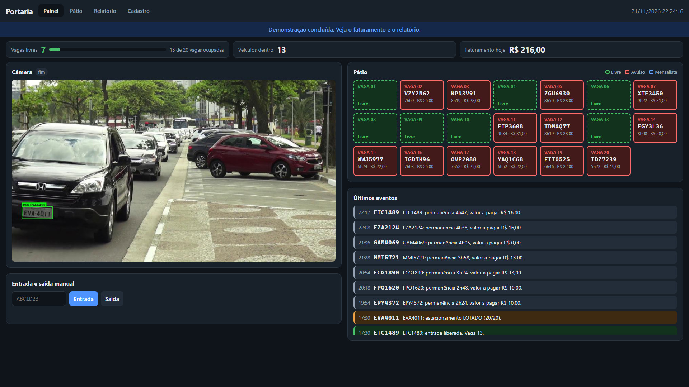
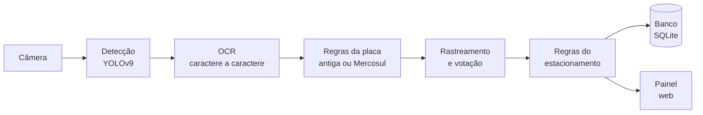
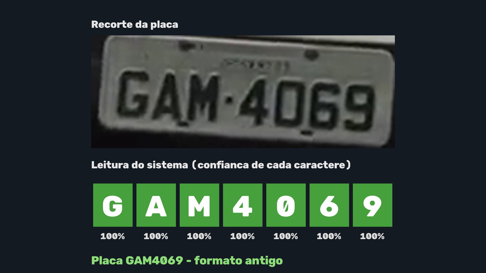

# Leitor de Placas


Sistema de leitura automática de placas brasileiras (formatos antigo e Mercosul) para a portaria de um **estacionamento**. A câmera lê a placa, o sistema registra entrada e saída, ocupa e libera vagas, calcula o valor a pagar e avisa a portaria sobre veículos bloqueados ou pátio lotado. Tudo roda num computador comum, só no processador, sem placa de vídeo e sem internet.



| 98,7% | 18 de 19 | 0 | 132 |
|:---:|:---:|:---:|:---:|
| de precisão nas leituras aceitas | placas do gabarito lidas certo | carros registrados em duplicidade | testes automatizados |

Projeto desenvolvido em etapas, do zero. O histórico de commits mostra a evolução.

## Sumário

- [O que ele faz](#o-que-ele-faz)
- [Demonstração rápida](#demonstração-rápida)
- [Como funciona](#como-funciona)
- [Resultados medidos](#resultados-medidos)
- [Decisões técnicas](#decisões-técnicas)
- [Como instalar](#como-instalar)
- [Como usar](#como-usar)
- [Privacidade (LGPD)](#privacidade-lgpd)
- [Créditos e licenças](#créditos-e-licenças)

## O que ele faz

- **Detecta e lê placas** em vídeo, webcam ou câmera IP (RTSP), validando pelas regras da placa brasileira e corrigindo confusões comuns de OCR (O↔0, B↔8…).
- **Um carro, um registro**: acompanha cada veículo enquanto ele está na tela e escolhe a leitura mais votada.
- **Estacionamento**: entrada e saída pareadas, vaga numerada para cada carro, tempo de permanência e valor a pagar.
- **Alertas para a portaria**: veículo *bloqueado* e pátio *lotado* (mensalistas têm vaga garantida).
- **Painel web** que abre no navegador, inclusive no celular: vagas livres, desenho do pátio, vídeo ao vivo, eventos coloridos, entrada e saída manual, relatórios e cadastro. A aba *Pátio* mostra a lotação e quem está dentro e pode ficar fixa num segundo monitor (`http://localhost:8000/#lotacao`).
- **Câmera de verdade**: leitura em thread separada, sempre do quadro mais recente, com reconexão automática quando a rede cai.
- **Medição**: a taxa de acerto foi medida contra um gabarito conferido à mão, e os limites de confiança foram escolhidos pelos números.

## Demonstração rápida

Sem câmera de estacionamento à mão, a demonstração usa um vídeo de rua comum duas vezes: primeiro como câmera da **entrada** e depois como câmera da **saída**.

```
python -m leitor.web --demo videos/pexels_fabio_reis_de_abreu.mp4
```

Abra http://localhost:8000. O roteiro, de cerca de 1 minuto e meio:

1. **Pátio já em uso**: 13 carros estacionados e 7 dias de histórico (faturamento, horários de pico e frequentes).
2. **Câmera da entrada** (30 s do vídeo): os carros chegam e cada um ocupa uma vaga, que pisca no desenho do pátio. A mensalista entra liberada, o veículo bloqueado é barrado com alerta vermelho e o último carro encontra o pátio **lotado**.
3. **⏩ 2 horas depois**: o relógio do painel corre rápido.
4. **Câmera da saída** (os mesmos 30 s): com o relógio acelerado (1 s = 5 min), cada carro fica um tempo diferente e paga um valor diferente. As vagas são liberadas e o faturamento sobe.

A demonstração usa um banco próprio (`data/demo.db`), recriado a cada execução, e não mexe no banco de verdade. As placas do histórico são inventadas.

## Como funciona



1. **Detecção**: um modelo YOLOv9 encontra a placa no quadro e devolve a caixa e a confiança.
2. **OCR**: o recorte da placa é lido caractere a caractere, cada um com a sua confiança.
3. **Regras da placa**: o texto tem que seguir o formato antigo (`AAA9999`) ou o Mercosul (`AAA9A99`). Onde só pode haver número, um "O" vira "0", e vice-versa.
4. **Rastreamento e votação**: o mesmo carro aparece em dezenas de quadros. O sistema liga a placa de um quadro ao seguinte e, quando o carro sai da tela, fica com a leitura mais votada.
5. **Regras do estacionamento**: decide se libera, barra (bloqueado) ou avisa que lotou, escolhe a vaga e, na saída, calcula o valor.



| Módulo | Função |
|---|---|
| `leitor/placa.py` | Valida o formato e corrige confusões de OCR pela posição. |
| `leitor/deteccao.py` | Encontra as placas no quadro (caixa e confiança). |
| `leitor/ocr.py` | Lê os caracteres do recorte, com confiança por caractere. |
| `leitor/medicao.py` | Compara as leituras com um gabarito para escolher os limites. |
| `leitor/rastreamento.py` | Liga a placa entre quadros (IoU ou distância) e escolhe a leitura mais votada. |
| `leitor/motor.py` | Junta tudo para cada quadro. É usado pelo painel e pela linha de comando. |
| `leitor/banco.py` | SQLite: veículos cadastrados e acessos (entrada, saída, vaga, valor). |
| `leitor/regras.py` | Valor a pagar e decisão na entrada. São funções puras, fáceis de testar. |
| `leitor/estacionamento.py` | Regras + banco: entrada com vaga, saída com valor, relatórios. |
| `leitor/camera.py` | Leitura em thread, quadro mais recente, reconexão automática. |
| `leitor/web/` | Painel web (FastAPI + HTML/CSS/JS sem frameworks). |
| `leitor/demo.py` | Banco e roteiro da demonstração. |

**Tecnologias:** Python, OpenCV, ONNX Runtime, open-image-models (YOLOv9), fast-plate-ocr, SQLite, FastAPI, HTML/CSS/JavaScript e pytest.

## Resultados medidos

### Leitura

Vídeo de teste, 1 a cada 10 quadros (316 quadros, 694 leituras). O gabarito tem 19 placas conferidas à mão no vídeo.

| Filtro | Leituras aceitas | Precisão | Placas lidas certo |
|---|---|---|---|
| Nenhum | 603 | 68,3% | 19 de 19 |
| Confiança ≥ 0,80 | 354 | 86,4% | 19 de 19 |
| Confiança ≥ 0,80 e largura ≥ 60 px | 238 | **98,7%** | **18 de 19** |

**Limites escolhidos: confiança mínima de 0,80 e placa com pelo menos 60 px de largura.**

- Só a confiança não basta. Placas de longe (cerca de 50 px) são lidas errado *com confiança alta*: um "W" vira "V" com 97% de confiança. O tamanho da placa separa esses casos muito melhor.
- Abaixo de 60 px, as leituras erradas disparam (40 com largura de 50 px, contra 3 com 60 px). Acima de 60 px, a precisão quase não melhora e o sistema começa a perder placas (16 de 19 com 70 px).
- Acima de 0,80 de confiança, a precisão sobe pouco e uma placa a mais deixa de ser lida.
- A placa perdida é a de um carro estacionado ao fundo, que nunca passa de 55 px. Ela não seria lida com segurança nem por uma pessoa.

### Um carro, um registro

No vídeo inteiro: **17 registros, nenhum duplicado**. Foram 16 placas certas e 1 errada: FPO1620 no lugar de FPD1620, porque o OCR confunde D com O de forma sistemática nessa placa e a votação não corrige um erro que se repete. Das 19 placas do gabarito, 2 ficaram sem registro porque nunca apareceram grandes o bastante para uma leitura confiável.

## Decisões técnicas

- **Limites escolhidos por medição, não por intuição.** O gabarito mostrou que o tamanho da placa separa leituras ruins melhor que a confiança do OCR (veja acima).
- **Votação ponderada.** Cada leitura confiável vota com peso igual à sua confiança. Isso corrige erros aleatórios. Erros sistemáticos, como o D↔O da FPD1620, continuam aparecendo e estão documentados.
- **Sempre o quadro mais recente.** A câmera é lida numa thread separada que descarta quadros atrasados. Se o processamento ficar lento, o sistema perde quadros, mas não acumula atraso.
- **Regras como funções puras.** O cálculo do valor e a decisão na entrada não dependem de banco nem de câmera, por isso são testados com tabelas de casos.
- **Dinheiro em centavos.** Os valores são inteiros, para não acumular erro de arredondamento.
- **Cancela fechada com alerta.** Veículo bloqueado ou pátio lotado não entram sozinhos. O operador pode liberar pelo painel, e fica registrado.
- **Demonstração reproduzível.** No modo demo, o vídeo é lido quadro a quadro, então o resultado não muda se o computador estiver ocupado.

## Como instalar

Requer Python 3.11 ou mais novo.

```
python -m venv .venv
.venv\Scripts\activate
pip install -r requirements.txt
```

A `open-image-models` e a `fast-plate-ocr` instalam junto o `opencv-python-headless` (OpenCV sem janelas). Se as janelas do OpenCV não abrirem, reinstale o OpenCV completo:

```
pip uninstall -y opencv-python-headless opencv-python
pip install opencv-python==5.0.0.93
```

Na primeira execução, os modelos de detecção e de OCR (poucos MB) são baixados automaticamente.

O vídeo de teste não fica no repositório. Baixe-o no Pexels (crédito abaixo) e salve-o na pasta `videos/`.

## Como usar

### Painel da portaria

```
python -m leitor.web                                          # só o painel, sem câmera
python -m leitor.web --video videos/pexels_fabio_reis_de_abreu.mp4 --repetir
python -m leitor.web --camera-env                             # câmera IP do arquivo .env
python -m leitor.web --camera-env --host 0.0.0.0              # libera para o celular na mesma rede
```

Para usar uma câmera IP, copie `.env.example` para `.env` e preencha o endereço RTSP com usuário e senha. O `.env` fica fora do Git, e a senha aparece como `***` nos logs e no painel. Use `--tipo saida` se a câmera filmar a saída.

Para ver a reconexão automática sem desligar o cabo de uma câmera, `--simular-queda 300` derruba a conexão a cada 300 quadros. O painel mostra "reconectando…" e volta sozinho.

Em telas que não mostram o vídeo contínuo (MJPEG), abra o painel com `?imagem` no endereço (por exemplo, `http://localhost:8000/?imagem`). Ele passa a mostrar a foto mais recente da câmera, atualizada a cada segundo. A foto também fica disponível em `/quadro.jpg`.

### Estacionamento pela linha de comando

```
python -m leitor.banco cadastrar GAM4069 "Ana Souza" mensalista
python -m leitor.banco cadastrar BZR7297 "Carlos Lima" bloqueado --observacao inadimplente
python -m leitor.banco dentro                     # quem está dentro agora?
python -m leitor.banco historico GAM4069          # quanto tempo o carro ficou?
python -m leitor.banco dia 2026-10-28             # acessos de um dia
python -m leitor.banco limpar --dias 90           # apaga passagens antigas (LGPD)

python -m leitor.estacionamento vagas
python -m leitor.estacionamento entrada EPY4372   # à mão, se a câmera falhar
python -m leitor.estacionamento saida EPY4372     # mostra o valor a pagar
python -m leitor.estacionamento relatorio --de 2026-10-01 --ate 2026-10-31
```

Processar um vídeo inteiro de uma vez e gravar no banco:

```
python -m leitor.processar videos/pexels_fabio_reis_de_abreu.mp4 --banco data/estacionamento.db --inicio "2026-10-28 08:00:00"
python -m leitor.processar videos/pexels_fabio_reis_de_abreu.mp4 --banco data/estacionamento.db --camera saida
```

### Preços e vagas

Ficam em [config.toml](config.toml). A tabela padrão é a de um shopping típico:

| Regra | Valor |
|---|---|
| Tolerância | até 15 min grátis |
| Valor base | R$ 10,00 até 3 horas |
| Hora adicional (ou fração) | R$ 3,00 |
| Teto | R$ 40,00 a cada 24 horas |
| Mensalista | não paga |
| Vagas | 20 |

Na entrada, um veículo **bloqueado** ou um avulso com o pátio **lotado** gera alerta, e a cancela fica fechada (a entrada não é gravada). Se o operador decidir liberar, ele usa o botão *Entrada* do painel, que grava a passagem mesmo com alerta.

### Ferramentas de cada etapa

Estas ferramentas mostram cada parte do sistema separada:

```
python -m leitor.video videos/pexels_fabio_reis_de_abreu.mp4                  # abre o vídeo e desenha
python -m leitor.deteccao videos/pexels_fabio_reis_de_abreu.mp4 --quadro 150  # marca as placas
python -m leitor.ocr videos/pexels_fabio_reis_de_abreu.mp4 --quadro 1200      # lê os caracteres
python -m leitor.medicao coletar videos/pexels_fabio_reis_de_abreu.mp4        # coleta leituras
python -m leitor.medicao conferir videos/pexels_fabio_reis_de_abreu.mp4       # confere quadro a quadro
python -m leitor.medicao avaliar capturas/leituras_pexels_fabio_reis_de_abreu.csv data/gabarito_pexels_fabio_reis_de_abreu.csv --limite 0.80 --largura-minima 60
python -m leitor.processar videos/pexels_fabio_reis_de_abreu.mp4              # um registro por carro
```

Rodar os testes:

```
pytest
```

## Privacidade (LGPD)

Placa de veículo é **dado pessoal**: com ela, dá para chegar ao dono. O projeto foi pensado para tratar esse dado com cuidado:

- **Finalidade**: as placas são usadas só para controlar o acesso e cobrar a permanência.
- **Minimização**: o sistema guarda a placa, os horários, a vaga e o valor. **Imagens e vídeos não são gravados**: cada quadro é analisado e descartado.
- **Prazo de guarda**: `python -m leitor.banco limpar --dias 90` apaga as passagens encerradas há mais de 90 dias. Carros ainda dentro e o cadastro de mensalistas não são apagados. O prazo deve ser definido pelo responsável pelo estacionamento e informado aos clientes.
- **Tudo local**: o banco é um arquivo SQLite no próprio computador. Nada é enviado para a internet. Os modelos rodam no processador local.
- **Fora do Git**: bancos, vídeos, planilhas de medição e o `.env` com a senha da câmera estão no `.gitignore`.
- **Acesso ao painel**: o painel não tem login. Por padrão, ele só abre no próprio computador (`127.0.0.1`). Com `--host 0.0.0.0`, qualquer aparelho da rede local acessa, então use só em rede confiável e **nunca exponha o painel na internet**.
- **Transparência**: quem instalar o sistema deve sinalizar no local que há câmera com leitura de placas e para quê (por exemplo, uma placa na entrada) e atender pedidos dos titulares. O comando `historico` mostra tudo que existe sobre uma placa.
- **Demonstração**: o vídeo de teste é público (Pexels), e as placas do histórico da demonstração são inventadas.

## Créditos e licenças

### Vídeo de teste

Vídeo obtido no [Pexels](https://www.pexels.com) e usado sob a [licença do Pexels](https://www.pexels.com/license/). As imagens do painel e da leitura neste README foram geradas a partir dele.

- Vídeo de **Fábio Reis de Abreu (Portuga)**, no Pexels (`videos/pexels_fabio_reis_de_abreu.mp4`)

### Bibliotecas e modelos

- [open-image-models](https://github.com/ankandrew/open-image-models), de ankandrew, licença MIT. Detecta as placas com o modelo `yolo-v9-t-384-license-plate-end2end`.
- Os modelos de detecção são baseados no YOLOv9: Chien-Yao Wang e Hong-Yuan Mark Liao, *YOLOv9: Learning What You Want to Learn Using Programmable Gradient Information*, arXiv:2402.13616, 2024.
- [fast-plate-ocr](https://github.com/ankandrew/fast-plate-ocr), de ankandrew, licença MIT. Lê os caracteres com o modelo `cct-s-v2-global-model`.
- [ONNX Runtime](https://github.com/microsoft/onnxruntime), da Microsoft, licença MIT.
- [OpenCV](https://github.com/opencv/opencv), licença Apache 2.0.
- [NumPy](https://github.com/numpy/numpy), licença BSD-3-Clause.
- [FastAPI](https://github.com/fastapi/fastapi), licença MIT.
- [Uvicorn](https://github.com/encode/uvicorn), licença BSD-3-Clause.
- [HTTPX](https://github.com/encode/httpx), licença BSD-3-Clause (usada nos testes).
- [pytest](https://github.com/pytest-dev/pytest), licença MIT.

## Autor

Feito por **Elivan Lima Junior** ([@ElivanLimaJunior](https://github.com/ElivanLimaJunior)).

## Licença

Distribuído sob a licença MIT. Veja [LICENSE](LICENSE).
